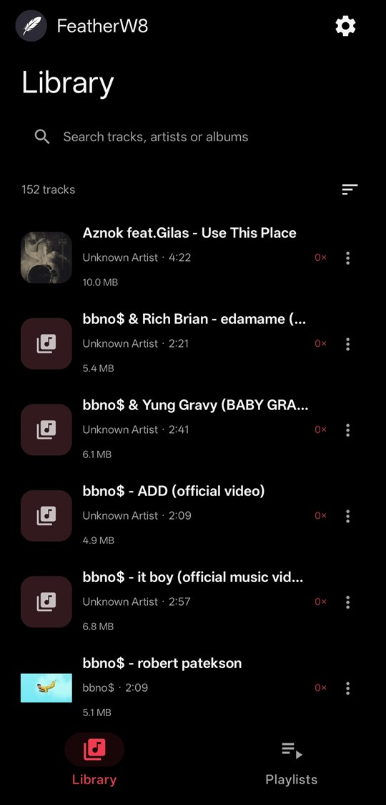
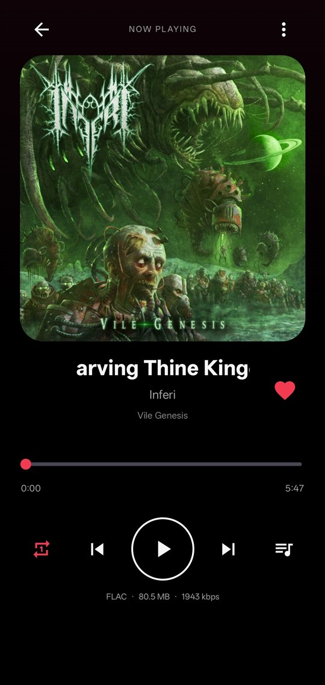
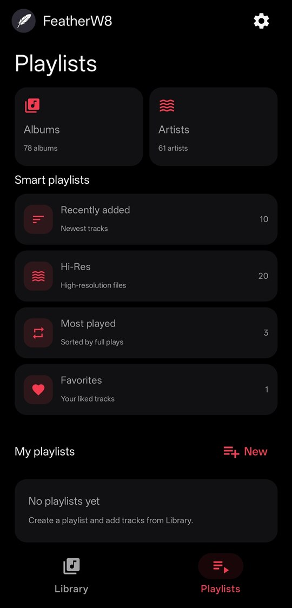
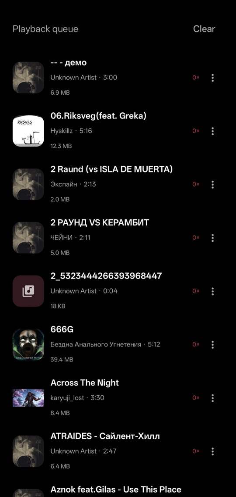
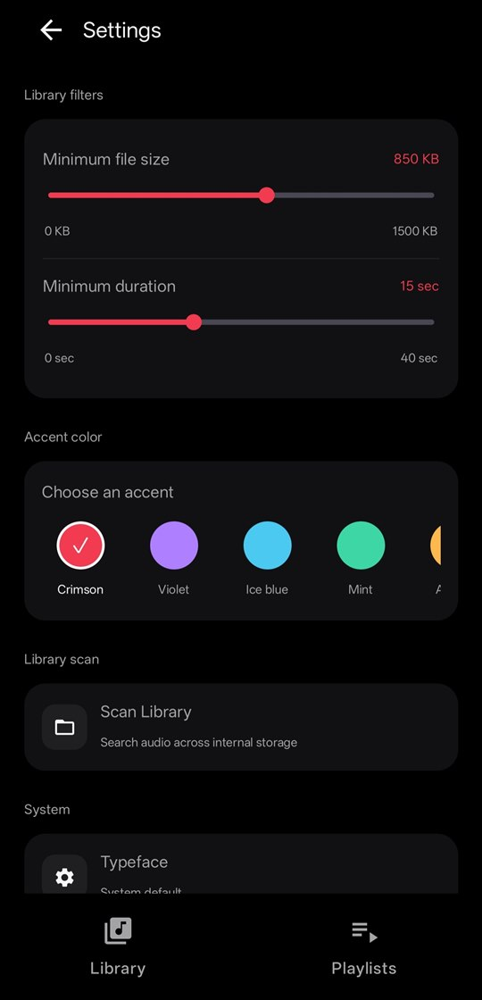

<p align="center">
  
</p>

<h1 align="center">FeatherW8</h1>

<p align="center">
  A lightweight offline music player for Android with a true-black AMOLED interface.<br>
  Plays your local library, including DSD (<code>DSF</code> and <code>DSDIFF</code>). No accounts, no ads, no telemetry, no network access, no nonsense.
</p>

<p align="center">
  <a href="https://github.com/lemitz/FeatherW8/releases"></a>
  
  
  
  
  <a href="https://github.com/lemitz/FeatherW8/actions/workflows/build.yml"></a>
</p>

<p align="center">
  <b>English</b> · <a href="README.ru.md">Русский</a>
</p>

<p align="center">
  Looking for the Windows terminal player? See <a href="https://github.com/lemitz/FeatherW8-CLI">lemitz/FeatherW8-CLI</a>.
</p>

---

FeatherW8 plays the music that is already on your phone. It scans the internal storage, shows the result as tracks, albums and artists, and plays it through [Media3](https://developer.android.com/media/media3). There is no streaming, no recommendations and no sign-in — the app does not even request the `INTERNET` permission, so it cannot phone home. Favorites, playlists and play counts live on the device.

Android has no DSD decoder, so FeatherW8 brings its own: a custom Media3 extractor reads DSF and DSDIFF files and a bundled native engine converts them to PCM on the fly (see [DSD playback](#dsd-playback)). A little device-specific polish — the NDot typeface on Nothing phones, Mini Capsule on realme, a 120 Hz refresh-rate request — is applied automatically where it exists and does nothing elsewhere.

## Screenshots

<table align="center">
  <tr>
    <td align="center"></td>
    <td align="center"></td>
    <td align="center"></td>
    <td align="center"></td>
    <td align="center"></td>
  </tr>
  <tr>
    <td align="center"><sub>Library</sub></td>
    <td align="center"><sub>Full player</sub></td>
    <td align="center"><sub>Playlists</sub></td>
    <td align="center"><sub>Queue</sub></td>
    <td align="center"><sub>Settings</sub></td>
  </tr>
</table>

## Features

**Library**
- Scans the phone's internal storage only — no SD cards or USB-OTG, and no source picker. The scan runs quietly whenever the app is opened; a manual scan in Settings always reports how many new tracks it found, including zero
- Search by title, artist, album or format; sort by track title, date added or play count; every row shows the file size
- Albums and Artists pages with artwork grids and track lists
- DSD files (`.dsf`, `.dff`, `.dsd`) are listed even where Android's media indexer does not classify them as audio, and they look like any other track: title, artist, album, cover, duration and bit rate come from the file's own tags and header (the indexer knows none of them)
- *Open with*: FeatherW8 is offered for audio files in file managers, DSD files included, and plays what you opened
- Two filters to hide clutter: minimum file size (0–1500 KB) and minimum duration (0–40 s)
- Long-press a track to select several, then add them to a playlist or the queue, share them or delete them (Android's own confirmation is kept). The per-track menu also offers file info and *Set as ringtone*

**Playlists**
- Smart playlists: *Recently added*, *Hi-Res*, *Most played* and *Favorites*
- Your own playlists: create, rename and delete with a long-press; deleting a playlist never deletes the audio files. Reorder the tracks or remove them from the ⋮ menu of a track
- Opening a playlist shows its tracks first — playback starts only when you pick a track or *Play all*

**Player**
- Mini player and full player, a queue that opens at the track that is playing and can be reordered or trimmed from the ⋮ menu, favorites, repeat off / all / one and shuffle; the repeat and shuffle choices survive a restart of the playback service
- File info on the full player: format, size and bitrate; tap the cover to pick your own artwork from storage
- Honest play counts: a track counts as played only after more than 90 % of it was actually heard — seeking never adds listened time
- Pauses by itself when the headphones are unplugged, so music does not continue through the speaker
- Playback runs in a Media3 session service, so it keeps going with the screen off

**Look and feel**
- True-black AMOLED surfaces and six accent colors: Crimson, Violet, Ice blue, Mint, Amber and Rose
- Long titles scroll in a smooth marquee; the pager between Library and Playlists follows your finger
- Asks for the display mode closest to 120 Hz at startup where the device offers one (the system still has the last word)
- Nothing phones use the system NDot typeface by default, switchable in Settings; realme's Mini Capsule needs no setup

**Fast lists**
- Covers are decoded off the main thread into a bounded memory cache and a JPEG disk cache (up to 96 MB, survives restarts); a background warmer pauses while you scroll
- Bitrates and other expensive track details are measured once and remembered; filtering and sorting run off the main thread

**Everything else**
- No telemetry, no ads, no accounts, no `INTERNET` permission
- Permissions: audio access to scan the library, notifications for the playback controls and — only for *Set as ringtone* — the system *Modify system settings* permission
- Two presses of Back exit the app from a top-level screen

## Gestures

| Action | Gesture |
|---|---|
| Switch Library ↔ Playlists | Swipe sideways, or use the bottom bar |
| Select several tracks | Long-press a track in Library |
| Rename or delete a playlist | Long-press it |
| Open the full player | Tap the mini player |
| Stop playback and dismiss the mini player | Drag it down |
| Close the full player (playback continues) | Drag it down, or press Back |
| Show the queue | Swipe left on the full player, or tap the queue button |
| File info | Tap the title on the full player |
| Change artwork | Tap the cover on the full player |

## DSD playback

DSF and uncompressed DSDIFF/DFF play like any other track. The pipeline is built from three pieces:

```
.dsf / .dff / .dsd
 └─ DsdExtractor.kt       Media3 extractor: sniffs and parses DSF / DSDIFF, deblocks and
     │                    bit-reverses DSF channel blocks, provides a seekable stream
     └─ dsd_jni.cpp       JNI bridge: complete 1/75-second frames of interleaved DSD
         └─ libdsdpcm     DSD-Nexus engine: DSD → 88.2 kHz, 16-bit PCM
             └─ ExoPlayer → Android's normal audio output
```

| Format | Handled by | Sent to the audio output |
|---|---|---|
| DSF | `DsdExtractor` + libdsdpcm | 16-bit PCM at 88.2 kHz |
| DSDIFF / DFF, uncompressed | `DsdExtractor` + libdsdpcm | 16-bit PCM at 88.2 kHz |
| DSDIFF / DFF, DST-compressed | not supported | — |

- Mono to six channels; the DSD rate must be a multiple of 600 Hz, which covers the usual DSD64 and higher rates
- A seek maps the target time to the nearest frame in the file and restarts the converter there so its filters start clean
- The last, partial frame is padded with the DSD silence pattern (`0x69`)
- Chunk sizes and offsets in the containers are bounds-checked, and a broken file fails with a readable error instead of a crash

Output is PCM, not native DSD (there is no DoP). The container parsers and the DSF bit-order handling are covered by unit tests ([`DsdExtractorTest.kt`](app/src/test/java/com/featherw8/player/audio/DsdExtractorTest.kt)).

## Installation

Download `FeatherW8-v<version>-arm64-v8a.apk` from the [Releases](https://github.com/lemitz/FeatherW8/releases) page and open it on the phone. The app is not on Google Play, so Android will ask you to allow installs from the app you opened the file with. Every release is an optimised build signed with the project's own key, so a newer release installs over the old one and keeps your favorites, playlists and play counts. Requirements: Android 9 (API 28) or newer and a 64-bit ARM (`arm64-v8a`) device.

Builds you make yourself are signed with your own debug key, so they cannot be installed over a release (uninstall the release first, or the other way round).

On first start FeatherW8 asks for access to audio files; without it the library stays empty.

## Development

Requirements:

- JDK 21
- Android SDK Platform 37, Build Tools 36.0.0, NDK `27.2.12479018` and CMake `3.22.1`
- An `arm64-v8a` device or emulator to run it

```bash
./gradlew :app:testDebugUnitTest :app:assembleDebug
```

The debug APK lands in `app/build/outputs/apk/debug/app-debug.apk`; `:app:assembleRelease` builds the optimised (R8) one, which is what is released. [BUILD_LOCAL.md](BUILD_LOCAL.md) has the complete setup, including a low-memory build script and the pinned Gradle, AGP and Kotlin versions. The test suite covers DSF/DSDIFF parsing, DSD tag and cover reading, and the play counter.

The [build workflow](.github/workflows/build.yml) runs for pushes to `main`, pull requests, version tags and manual dispatches. It runs the unit tests, builds the release APK, signs it with the project key (kept in repository secrets, never in the repo) and uploads it as an artifact. **Only a pushed version tag publishes a GitHub Release** with the APK and the notes from `docs/release-notes/<tag>.md`; the tag has to match `appVersionName` in `app/build.gradle.kts`.

### Versioning

Versions are `MAJOR.MINOR.PATCH`, chosen by how much a change matters to someone who updates:

- **PATCH** (1.3.0 → 1.3.1): bug fixes only; nothing to relearn.
- **MINOR** (1.3.0 → 1.4.0): new features or visible behavior changes that keep the user's data working.
- **MAJOR** (1.x → 2.0.0): a change that can break existing data or removes a feature.

The version is written once, as `appVersionName` in `app/build.gradle.kts`; `versionCode` is derived from it (`1.3.0` → `10300`), so the two cannot drift apart.

To publish a release, bump `appVersionName`, add `docs/release-notes/v<version>.md`, merge to `main` and then:

```bash
git switch main
git pull --ff-only
git tag -a v<version> -m "FeatherW8 <version>"
git push origin v<version>
```

## Known limitations

- Android 9+ and `arm64-v8a` only.
- Only the phone's internal storage is scanned — no SD cards, no USB-OTG.
- DST-compressed DSDIFF is not supported, and DSD is always converted to PCM; native DSD / DoP output is not implemented.
- No tag editor and no online metadata or cover lookup (the app has no network access). Covers come from the media index, or from an image you pick yourself.
- Releases are signed with the project's own key and published on GitHub only; there is no Play Store build.

## Project structure

```
app/src/main/
  java/com/featherw8/player/
    MainActivity.kt              theme, navigation, screens, mini and full player, gestures
    audio/
      DsdExtractor.kt            Media3 extractor: DSF / DSDIFF parsing, seek map, DSD → PCM frames
      NativeDsdDecoder.kt        JNI wrapper around the native converter
    data/
      MediaLibraryRepository.kt  MediaStore scan of the primary volume, plus DSD files
      MusicTrack.kt              track model with precomputed labels
      ActualPlayCounter.kt       "really listened" counter; seeks never count
      PlayCountStore.kt          play counts
      TrackInfoStore.kt          remembered bitrates
      CoverDiskCache.kt          JPEG cover cache in cacheDir
      TrackFormat.kt             duration and size formatting
    playback/PlaybackService.kt  Media3 session service, ExoPlayer, repeat / shuffle persistence
  cpp/
    dsd_jni.cpp                  JNI bridge to the converter
    external/libdsdpcm/          engine bindings
    third_party/dsd-nexus/       vendored libdsdpcm and libsautil (LGPL-2.1)
  assets/third_party_licenses/   LGPL text, shipped inside the APK
app/src/test/                    DsdExtractorTest, ActualPlayCounterTest
docs/                            screenshots and release notes
.github/workflows/build.yml      tests and a signed release APK on every push; release on v* tags
BUILD_LOCAL.md                   full local build instructions
THIRD-PARTY-NOTICES.md           licenses of the bundled and linked components
```

## Tech stack

[Kotlin](https://kotlinlang.org) · [Jetpack Compose](https://developer.android.com/compose) (Material 3) · [AndroidX Media3](https://developer.android.com/media/media3) (ExoPlayer, Extractor, Session) · [kotlinx.coroutines](https://github.com/Kotlin/kotlinx.coroutines) · C++20 / CMake / NDK · [DSD-Nexus](https://github.com/wichers/dsd-nexus) (`libdsdpcm`, `libsautil`) · Gradle 9 · Android Gradle Plugin 9

Looking for the Windows terminal version? That's [lemitz/FeatherW8-CLI](https://github.com/lemitz/FeatherW8-CLI).

## License

FeatherW8 is released under the [MIT License](LICENSE). The bundled DSD-to-PCM engine (`libdsdpcm`, `libsautil` from [DSD-Nexus](https://github.com/wichers/dsd-nexus)) is licensed under the **GNU LGPL v2.1**; its source is vendored in this repository and built into `libfeather_dsd.so`, and the license text ships in the APK. Other third-party components keep their own licenses; see [THIRD-PARTY-NOTICES.md](THIRD-PARTY-NOTICES.md).

---

<p align="center">
  <br>
  <sub>This project was built with the help of AI tools.</sub>
</p>
